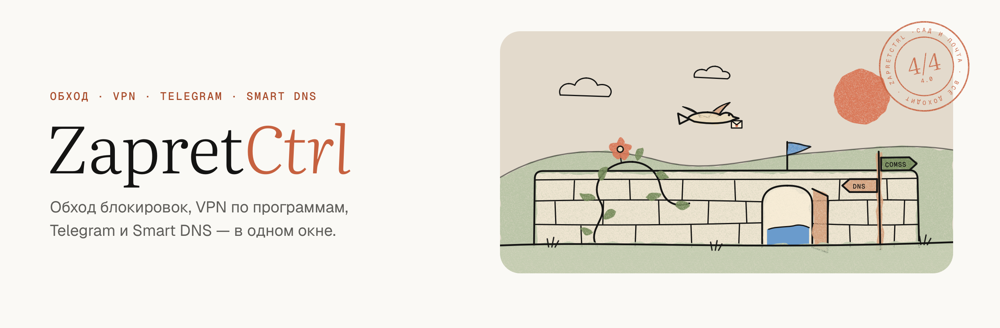
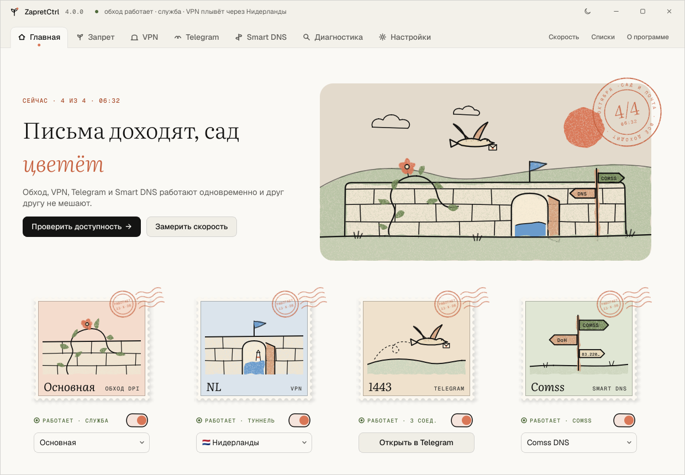
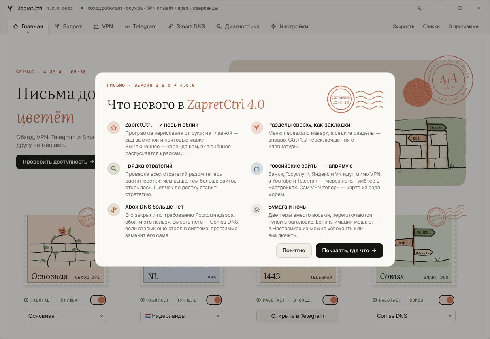
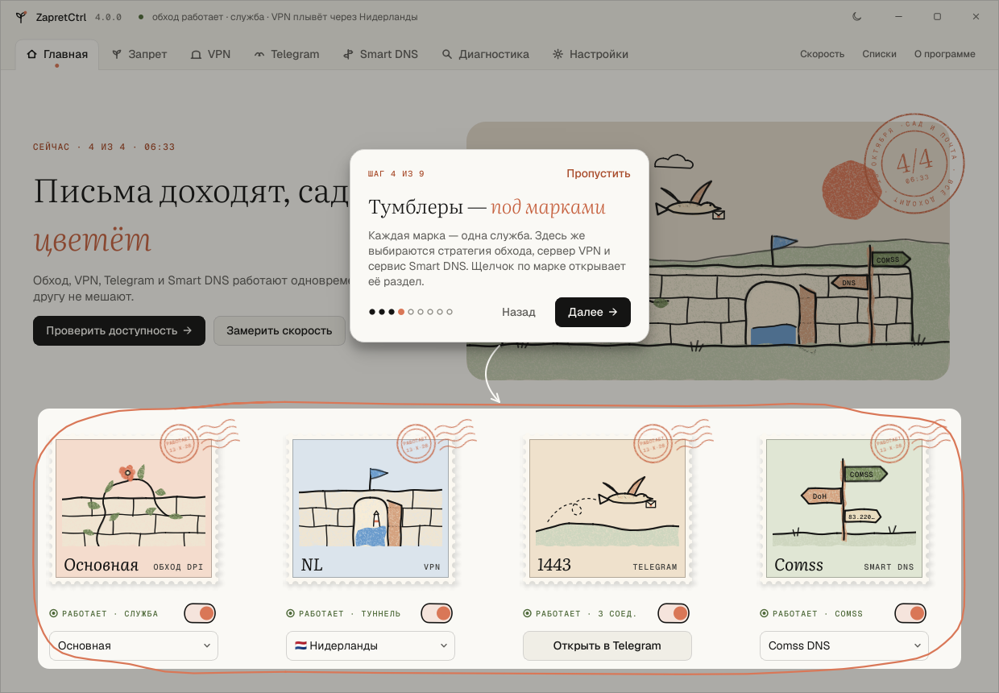
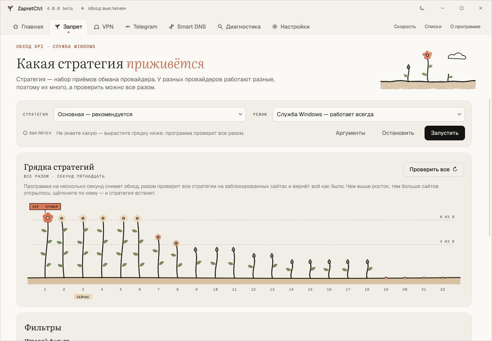
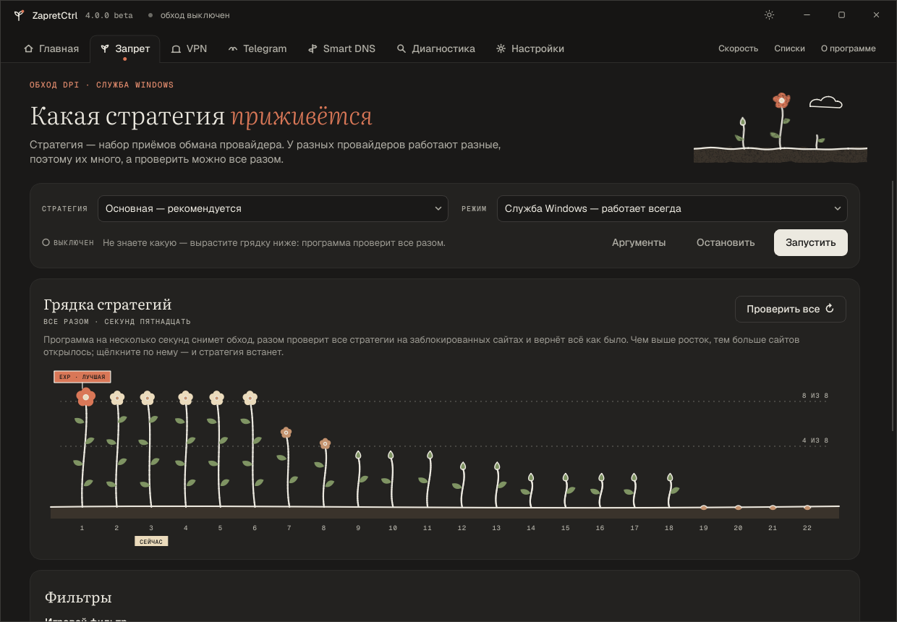
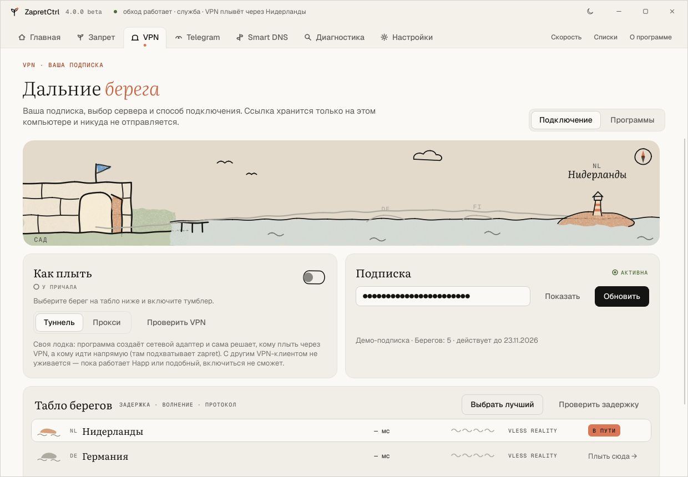
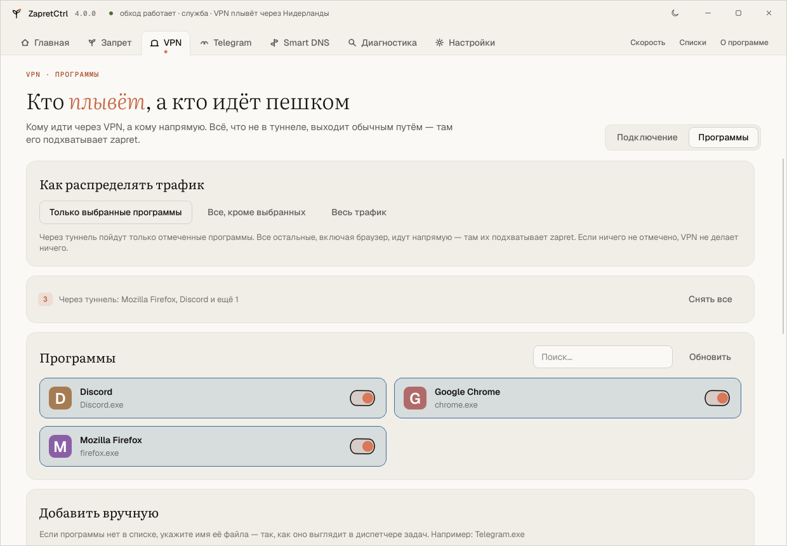
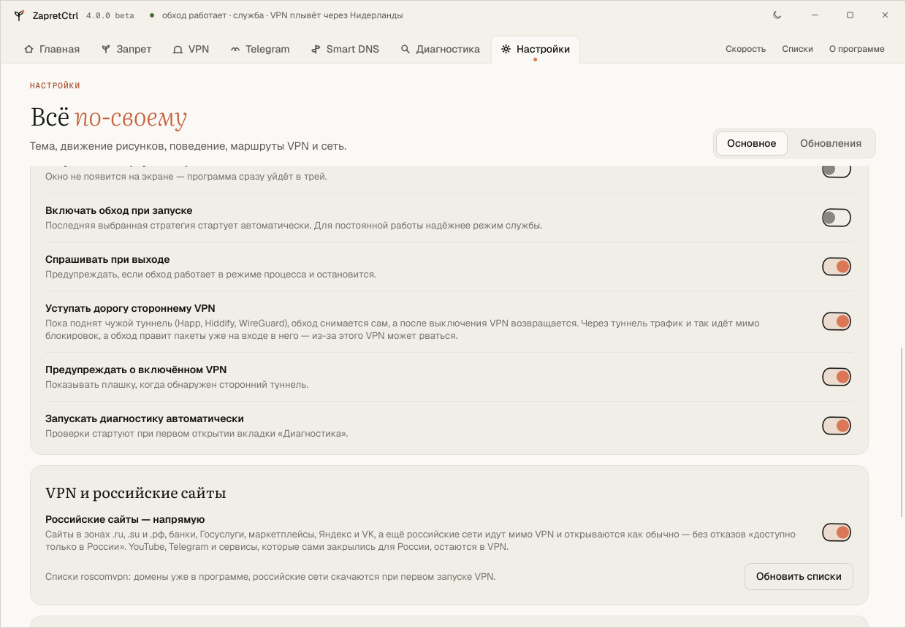
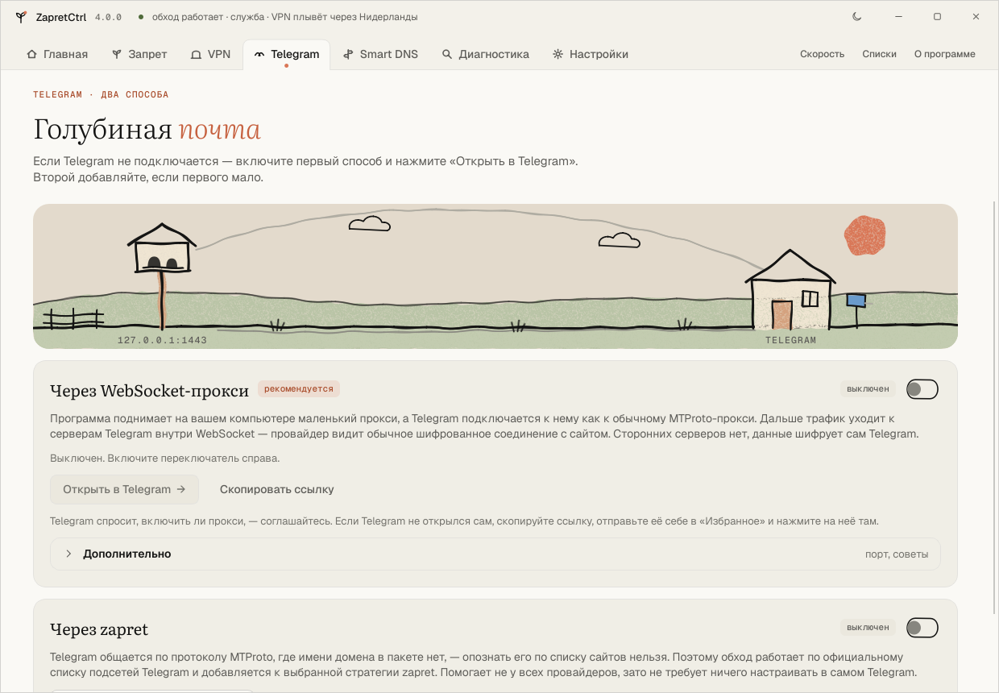

<div align="center">



[](https://github.com/77WhyNot/ZapretControlPlus/releases/latest)
[](https://github.com/77WhyNot/ZapretControlPlus/releases)
[](https://github.com/77WhyNot/ZapretControlPlus/releases/latest)
[](LICENSE)

### Обход блокировок, VPN по программам, Telegram и Smart DNS — в одном окне

С версии 4.0 программа называется **ZapretCtrl** (раньше — Zapret Control+) и
нарисована от руки: сад за стеной, почтовые марки и море.

Всё, что умеет [Zapret Control](https://github.com/77WhyNot/ZapretControl), плюс VPN
из вашей подписки: туннель только для выбранных программ или прокси, который
уживается с любым другим VPN-клиентом. Российские сайты при этом идут мимо VPN
и открываются как обычно.

**[⬇ Скачать последнюю версию](https://github.com/77WhyNot/ZapretControlPlus/releases/latest)**

</div>

<div align="center">

</div>

---

## Главная: сад, штемпель и четыре марки

Сверху — сад за каменной стеной: лоза на стене — обход, калитка к морю — VPN,
птица с письмом — Telegram, указатель — Smart DNS. Выключенное нарисовано
карандашом, включённое распускается красками, а штемпель считает, сколько из
четырёх работает. Ниже — четыре почтовые марки с тумблерами, и под каждой сразу
выбор:

| | |
|---|---|
| **Обход DPI** | zapret: ломает распознавание домена у провайдера. Сайты, YouTube, Discord — сразу для всей системы, скорость не падает. Стратегия выбирается прямо на плитке. |
| **VPN** | Ваша подписка (VLESS, Reality, VMess, Trojan, Shadowsocks, Hysteria2, Xray-формат). Сервер меняется на плитке без перезапуска туннеля. |
| **Telegram** | Прокси через WebSocket внутри программы (ядро [tg-ws-proxy](https://github.com/Flowseal/tg-ws-proxy)): включить и нажать «Открыть в Telegram». |
| **Smart DNS** | Сервисы, закрытые для России по стране: нейросети, игровые сервисы, Spotify. Comss DNS, Cloudflare, AdGuard или Google — из списка. |

Внизу — **«Проверить доступность»** и **«Замерить скорость»**: загрузка, отдача,
задержка и разброс тем же путём, которым сейчас идёт трафик, — то есть настоящая
скорость через VPN или обход, а не «скорость тарифа». Если в системе работает
другой VPN — туннелем или прокси, как Happ, v2rayN, Hiddify, — над схемой
появится небольшая плашка «может мешать». Программа следит за этим постоянно и
сама чужой VPN не трогает.

> **Где Xbox DNS?** Закрыт в октябре 2026 года: по требованию ЦМУ ССОП
> (Роскомнадзора) хостинг заблокировал сервис, а DNS-запросы к его адресам
> провайдеры режут. Со стороны программы это не обойти, поэтому сервис убран.
> Если он ещё стоял в системе, ZapretCtrl сам заменит его на Comss DNS.

<div align="center">

</div>

## Разделы

Разделы — закладками сверху: **Главная · Запрет · VPN · Telegram · Smart DNS ·
Диагностика · Настройки**, а справа, мельче, — скорость интернета, списки сайтов
и «О программе». С клавиатуры — Ctrl+1…7 и Ctrl+Tab.

- **Запрет** — стратегия из выпадающего списка, режим работы (служба или процесс),
  подбор стратегии, игровой фильтр (со своими портами, если нужно) и IPSet, а также
  перезапуск Discord с очисткой кэша: после смены стратегии он чаще всего и чинит
  голос. Полный список из двадцати с лишним стратегий свёрнут и открывается по щелчку.
- **VPN** — две вкладки: **«Подключение»** (подписка, табло серверов, туннель или
  прокси) и **«Программы»** (кто идёт через VPN, а кто напрямую).
- **Telegram** — голубятня: прокси через WebSocket внутри программы или обход
  через zapret, ссылка для Telegram копируется одной кнопкой.
- **Настройки** — тоже две вкладки: **«Основное»** (тема, движение рисунков,
  поведение, «Российские сайты — напрямую», сеть) и **«Обновления»**.

Окно тянется мышкой за любой край и угол — от маленького до во весь экран.
В узком окне у закладок остаются значки, редкие разделы уходят в «Ещё», а марки
главной встают по две.

Две темы — **Бумага** и **Ночь** (или «как в Windows»), переключаются луной в
заголовке. Рисунки живут: линии чуть дышат, листья качаются, лодка плывёт. Если
это лишнее — в Настройках движение можно успокоить или выключить; при
выключенных анимациях Windows рисунки стоят сами. При первом запуске программа
коротко показывает, где что, а после обновления — что изменилось.

Программа живёт в трее у часов. Из меню значка можно включить и выключить
обход и VPN, не открывая окно, а в подсказке видно, что сейчас работает.

<div align="center">


</div>

<div align="center">

</div>

### Все стратегии — разом

Кнопка **«Проверить все»** на вкладке «Запрет» проверяет двадцать с лишним
стратегий одновременно, а не по очереди: 15–20 секунд вместо пары минут. Каждая
стратегия запускается своей копией winws и перехватывает только свои порты,
поэтому копии не мешают друг другу. Проверка идёт только по сайтам, которые без
обхода у вас не открываются, — на них и видна разница.

Результаты вырастают на **грядке**: каждая стратегия — росток, и чем больше
сайтов она открыла, тем он выше. Лучшая расцветает глиняным цветком и ставится
одной кнопкой или щелчком по ростку; ваша текущая помечена. Подробности по
каждому сайту — в раскрывающемся списке под грядкой. Обход на время проверки
снимается и потом возвращается таким, каким был.

<div align="center">

</div>

## Два способа подключить VPN

<div align="center">


</div>

**Туннель.** Программа создаёт сетевой адаптер и сама решает, кому идти через VPN,
а кому напрямую: только выбранные программы, все кроме выбранных или весь трафик.
Всё, что идёт напрямую, подхватывает zapret — обход и VPN дополняют друг друга.
Адреса серверов подписки автоматически заносятся в исключения zapret, иначе он
порезал бы трафик до самого VPN-сервера. Туннель без IPv6 не раздаёт программам
IPv6-адреса — иначе они уходили бы по IPv6 мимо него. С другим работающим
VPN-клиентом туннель не уживается: пока поднят Happ, Hiddify, WireGuard и
подобные, программа честно скажет об этом и не станет ничего ломать.

**Прокси.** sing-box слушает только на вашем компьютере, а Windows направляют туда
системный прокси. Ни адаптера, ни маршрутов, ни перехвата DNS — режим работает
рядом с любым другим VPN. Через VPN идут браузеры, Discord и всё, что уважает
системный прокси; выбор программ в этом режиме не действует.

Правила на вкладке «Программы» применяются сами через пару секунд после правки:
сколько бы программ вы ни отметили подряд, туннель перезапустится один раз и уже
со всеми правилами. Имя программы сопоставляется без учёта регистра.

Туннель поднимается за одну–две секунды, в том числе при смене сервера или
режима. Подписка обновляется сама раз в полсуток: провайдеры меняют серверы и
ключи, а работающий VPN при этом не рвётся — новый список вступает в силу при
следующем включении.

## Российские сайты — напрямую

Банки, Госуслуги, маркетплейсы, Яндекс, VK и вообще сайты в зонах .ru, .su и
.рф с зарубежного адреса часто не открываются или просят подтверждений. Поэтому
всё российское идёт **мимо VPN** — и по доменам, и по российским IP-сетям, — а
YouTube, Telegram и сервисы, которые сами закрылись для России (ChatGPT и
подобные), остаются **в туннеле**, даже если их кэш-сервер стоит у вашего
провайдера и адрес у него российский.

Правила повторяют профиль Happ «RU direct», списки — проекта
[roscomvpn](https://github.com/hydraponique/roscomvpn-geosite): доменные вшиты в
программу, IP-сети скачиваются при первом запуске VPN, дальше всё обновляется
само раз в сутки — движок подхватывает свежие списки без перезапуска. Работает
во всех режимах: в «Только выбранные программы» правило касается только их,
в режиме «Прокси» — всего, что идёт через системный прокси.

Переключатель — **Настройки → «VPN и российские сайты»**, включён по умолчанию.

<div align="center">

</div>

## Telegram

<div align="center">

</div>

Telegram Desktop подключается к маленькому MTProto-прокси прямо в программе, а
дальше трафик идёт к серверам Telegram через WebSocket — как обычный сайт. Нужно
только включить тумблер и нажать «Открыть в Telegram». Если провайдер режет и
это, второй способ — обход через zapret по официальному списку подсетей Telegram.

## Чужой VPN программа не трогает. Никогда

Ни адаптер, ни процесс, ни службу другого клиента. Программа убирает только
своё: свой процесс движка (по пути к файлу) и свой адаптер (по имени), и только
если они остались от прошлого запуска. Установщик снимает тоже только свой
`sing-box.exe`.

Если после старых версий 2.x у вас не поднимался VPN-клиент — «Диагностика» →
**«Починить сетевые адаптеры»** включит обратно то, что они выключали.

## Установка

1. Скачайте `ZapretControlPlus-Setup-x.y.z.exe` со страницы [Releases](https://github.com/77WhyNot/ZapretControlPlus/releases/latest).
2. Запустите и нажмите «Установить». Поверх старой версии установщик предложит обновить — настройки и подписка останутся.
3. Ядро zapret и движок VPN уже внутри — доскачивать ничего не нужно.

Программа просит права администратора: WinDivert грузит драйвер режима ядра,
служба zapret создаётся в системе, а туннель VPN поднимает сетевой адаптер.

Дальше программа обновляется сама: раз в сутки напоминает о новой версии, а по
щелчку скачивает и ставит её. После обновления с 3.x окно на секунду откроется
прежним обликом и «перекрасится» в новый, а значок на панели задач сменится сам. Ядро zapret со свежими стратегиями подтягивается
автоматически; в установщике уже версия 1.10.3.

### Первый запуск VPN

**VPN** → **Подключение** → вставьте ссылку-подписку → **Обновить**. Ссылка
хранится только на этом компьютере. Выберите сервер на табло (или «Выбрать
лучший»), способ подключения и включите переключатель — или просто тумблер VPN
на главной. Кнопка **«Проверить VPN»** покажет, каким адресом и из какой страны
вас видят снаружи — через сам туннель, а не мимо него.

## Чем отличается от [Zapret Control](https://github.com/77WhyNot/ZapretControl)

Обычная версия — без VPN, весит 24 МБ и не требует подписки. Plus добавляет VPN,
раздельный туннель и замер скорости. Если VPN не нужен, берите обычную.

## Как это работает

```
   программы
       │
       ├── напрямую ──────────────> интернет
       │        └─ здесь работает zapret (winws + WinDivert)
       │
       ├── выбранные ── TUN ── sing-box ──> VPN-сервер ──> интернет   (туннель)
       │                          │  ▲ адреса серверов — в исключениях zapret
       │                          └── российские сайты и сети ──> напрямую
       │
       └── системный прокси ── sing-box ──> VPN-сервер ──> интернет   (прокси)

Telegram Desktop ──> 127.0.0.1:1443 (MTProto-прокси внутри программы)
                         └──WebSocket/TLS──> серверы Telegram
```

## Сборка из исходников

Нужны Windows 10/11 x64, Python 3.10+ и [Inno Setup 6](https://jrsoftware.org/isdl.php).

```bash
pip install -r requirements.txt
```

```bash
powershell -ExecutionPolicy Bypass -File build\build.ps1
```

Скрипт сам скачает sing-box, нарисует иконку, прогонит проверки, соберёт
`dist\ZapretControlPlus\` и упакует установщик.

### Структура

```
app/core/       ядро: стратегии, winws, служба, проверка стратегий разом, Smart DNS, Telegram, замер скорости, обновления, диагностика
app/core/vpn/   VPN: разбор подписки, конфиг sing-box, маршруты (в т. ч. «российские сайты напрямую»), стыковка с zapret
app/vendor/     tg-ws-proxy — ядро прокси Telegram (MIT, без изменений)
app/ui/         интерфейс: тема «Пергамент», движок рисованных сцен (ink.py, scenes.py), разделы, знакомство
payload/zapret/ ядро zapret
payload/singbox/ движок VPN (скачивается при сборке)
```

## Автор

**ketamine** (Ivan Milyaev) — [github.com/77WhyNot](https://github.com/77WhyNot)

## Благодарности

- [bol-van/zapret](https://github.com/bol-van/zapret) — технология обхода и `winws`.
- [Flowseal/zapret-discord-youtube](https://github.com/Flowseal/zapret-discord-youtube) — стратегии и списки.
- [SagerNet/sing-box](https://github.com/SagerNet/sing-box) — движок VPN.
- [Flowseal/tg-ws-proxy](https://github.com/Flowseal/tg-ws-proxy) — прокси Telegram через WebSocket.
- [basil00/Divert](https://github.com/basil00/Divert) — драйвер WinDivert.
- [Comss DNS](https://www.comss.ru/page.php?id=7315) — Smart DNS для гео-ограничений.
- [hydraponique/roscomvpn](https://github.com/hydraponique/roscomvpn-geosite) — списки «Российские сайты — напрямую».

## Лицензия

Программа распространяется по [собственной лицензии](LICENSE): пользоваться и
делиться с друзьями можно свободно, а публиковать форки, изменённые версии и
брать код в свои проекты — **только с письменного разрешения автора**.

Сторонние компоненты остаются под своими лицензиями, sing-box — под GPL-3.0.
Подробности в [THIRD-PARTY-NOTICES.md](THIRD-PARTY-NOTICES.md).
